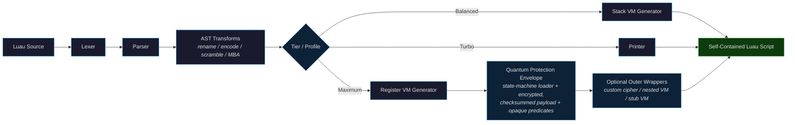
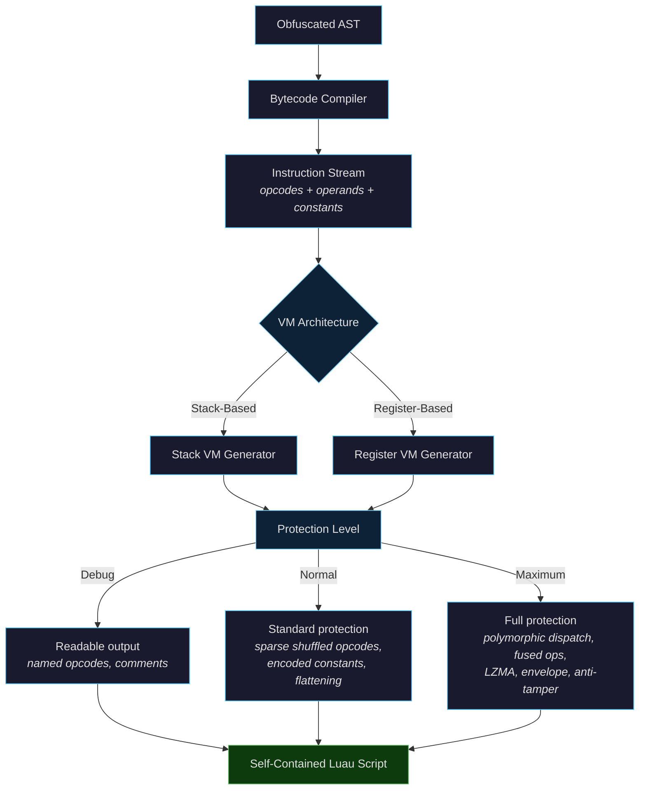

<div align="center">

# Quantum Obfuscator

**Advanced Luau Obfuscator with Dual-VM Protection, Guaranteed Determinism, and Executor Hardening**

A from-scratch Luau obfuscation engine in TypeScript: complete Lexer → Parser → AST → Obfuscator → VM pipeline with no external parsing dependencies, two virtual machine architectures, a layered protection envelope, and byte-identical reproducible builds.

[](../../releases/tag/v3.2.0)
[](https://www.typescriptlang.org/)
[](https://nodejs.org/)
[](./LICENSE)
[](https://github.com/QuantumXternal/Quantum-Obfuscator-LUA-LUAU/stargazers)

</div>

---

## v3.2.0 Release Highlights

- **Loader line-width bound (new)** — every emitted line (artifact + decrypted runtime) is capped at 9.6 KB (`MAX_OUTPUT_LINE_BYTES`) with per-piece long-bracket fragments; the 580 KB acceptance fixture drops from a 196,617-char single line to a **9,609-char max line**.
- **LZ4 payload compression (new)** — payloads are LZ4 block-compressed before the cipher stack and inflated in-artifact by a pure-Luau `unlz4` (chunked `table.concat` decode, **~140 ms on Luau**), with the adler32 checksum still verified over the inflated bytes. The 580 KB fixture lands at **1.38–1.44 MB** across seeds (was 2.29 MB). Pure-Luau deflate was implemented and rejected by the 200 ms boot-cost go/no-go (651 ms).
- **Clean loader failures** — payload loads run through pcall guards (`Quantum: payload load failed`); corrupted or truncated payloads produce the single `Quantum Protection V2` error on both runtimes, and `wrapNestedVM` passes >1.5 MB sources through instead of doubling pre-decode work.
- **Determinism retained** — same-seed builds stay byte-identical across CLI/API/UI (`benchmarks/seed-parity.mjs`, 6/6).
- **Quantum Studio (new)** — a four-page, local-first CodeMirror 6 workspace with AST hot-path analysis, clickable lint fixes, Analyzer-owned macro auto-detection, an IIFE banner with safe-site counts and one-click top-level IIFE refactoring, a no-repaste analyzer → obfuscator handoff, and the IIFE Turbo guide.
- **808 tests / 71 suites green**; acceptance seeds 10001–50005 (MAXIMUM + BALANCED) all ≤ 1.45 MB with reference-matched execution on Luau 0.742 + PUC-Lua 5.4.8.

---

## Overview

Quantum Obfuscator implements a complete obfuscation pipeline — tokenization, full Luau grammar parsing (including type annotations), composable AST transformations, bytecode compilation, VM code generation, and an optional protection envelope — all hand-written for maximum control and output quality.

### Key Features

- **Full Luau Support** — Complete lexer and parser covering the entire Luau grammar: type annotations, generics, if-else expressions, string interpolation, compound assignments, and `continue`
- **Dual VM Architectures** — Stack-based and register-based virtual machines; the register VM is the high-protection default with a sparse per-build opcode space, polymorphic dispatch, and fused super-ops
- **Quantum Protection Envelope** — Register-VM artifacts are wrapped in a layered state-machine loader with an encrypted + checksummed payload (XOR → 4-round Feistel → CBC), opaque predicates, and key/sbox integrity checks
- **Anti-Tamper** — Shadow PC/ip verification with polymorphic corruption on divergence; probes are calibrated to avoid false positives on stripped executors
- **Executor Hardening** — Graceful degradation when `getfenv` is blocked or `loadstring` is absent; no hard crashes on restricted environments
- **Guaranteed Determinism** — `polymorphicSeed` (number or 128-bit string path) plus optional per-wrapper seeds produce byte-identical builds on repeat
- **Dual-VM Nesting** — Register-VM payloads survive cipher/nested/stub wrapper layers and execute correctly on both Luau and PUC-Lua
- **MBA + CFF** — Mixed Boolean-Arithmetic constant encoding and a real state-machine control-flow flattening pass
- **Web UI + CLI + API** — Express server with an interactive dashboard, scriptable CLIs, and a JSON API with profiles and cached builds

---

## Performance Modes

Two complementary layers control protection strength. They land on the same VM modes — the API/UI profiles additionally set the AST passes.

### Performance Tiers (`performanceTier`, engine level)

| Tier | VM Stage | AST Passes | Character |
|------|----------|-----------|-----------|
| **Turbo** | none (AST only) | per flags | Fastest generation, smallest output, weakest structural protection |
| **Balanced** | Stack VM @ normal | per flags | Smaller artifacts with solid dispatch-level protection |
| **Maximum** | Register VM @ max | per flags | Strongest: polymorphic dispatch, sparse opcodes, envelope, anti-tamper checks |

### Protection Profiles (`profile`, API/UI level)

| Profile | AST Passes | VM | Notes |
|---------|-----------|-----|-------|
| `TURBO` | FAST (rename only) | none | Studio fast path; pairs with `performanceTier: "turbo"` unless VM overridden |
| `FAST` | Rename only | none | Smallest/fastest tier for build pipelines |
| `BALANCED` | Rename + string encoding + control-flow scramble | Register @ normal | **Studio default** |
| `MAXIMUM` | Rename + string encoding + control-flow scramble + MBA constants | Register @ max | Roblox anti-tamper bootstrap only when `target: "roblox"`; fully generic otherwise |
| `CUSTOM` | BALANCED base + explicit overrides | caller-selected | `vmType`/`vmLevel` omit = profile default; MBA defaults on only at `vmLevel: "max"` |

---

## Deobfuscation Resistance Matrix

All results below are **MEASURED** on real tool runs (see [SECURITY.md](./SECURITY.md) for per-artifact evidence, tool commit hashes, and reproduction commands). No evaluated tool achieved SUCCESS or PARTIAL — every classified result is refusal, crash, or garbage output.

| Tool | Commit | Result | Detail |
|------|--------|--------|--------|
| `JamiesNolandGiggleShi1er/ClydeDeobfuscator` | `87102086` | **5/5 REFUSE** | Exit 1, explicit refusal, no `.clean.lua` written |
| `caomod2077/Deobfuscator-Luraph-V15` | `892b48ac` | **5/5 GARBAGE** | Trace sandbox aborts on missing `bit32`/`string.pack`; 270-byte harness stubs, no source recovered |
| `larpcorrupt/luraph-v15-v14.x-deobfuscator` | `ed79a86c` | **5/5 CRASH** | `LiftError: could not find the VM loader` (Phase 1 baseline) |
| `0x251/Prometheus-Deobfuscator` | `7d0582fc` | **5/5 GARBAGE** | Dispatch analysis finds zero; annotated original only (Phase 1 baseline) |

Additional standing evidence: 10 adversarial cells (seeds `5, 17, 777, 31337, 90210` × reg/stack) all REFUSE with verbatim output and exit 1.

---

## Architecture

### End-to-End Pipeline



### VM Compilation Flow



### Project Structure

```mermaid
graph TD
    ROOT["Quantum-Obfuscator-LUA-LUAU/"] --> SRC["src/"]
    ROOT --> WEB["web/<br/><i>Studio modules + CodeMirror 6 editors</i>"]
    ROOT --> PUB["public/"]
    ROOT --> TESTS["tests/<br/><i>Engine + Studio Jest suites</i>"]

    SRC --> LEX["lexer/<br/><i>Tokenizer + token types</i>"]
    SRC --> PAR["parser/<br/><i>Recursive descent parser + type parser</i>"]
    SRC --> AST2["ast/<br/><i>AST node type definitions</i>"]
    SRC --> OBF["obfuscator/<br/><i>Renamer, StringEncoder,<br/>ControlFlowScrambler, MBA, Printer</i>"]
    SRC --> ENG["engine/<br/><i>Pipeline, protection profiles,<br/>analyzer + macro auto-injection</i>"]
    SRC --> VM["vm/<br/><i>Stack + Register compilers and<br/>generators, bootstrap envelope, LZMA</i>"]
    SRC --> CLI["cli/<br/><i>CLI entry points</i>"]
    SRC --> SRV["server.ts<br/><i>Express API + Studio static pages</i>"]

    PUB --> HTML["index / analyzer /<br/>obfuscator / docs"]
    PUB --> ASSETS["assets/<br/><i>generated esbuild bundle</i>"]
    WEB --> ASSETS

    style ROOT fill:#1a1a2e,stroke:#4fc3f7,color:#e0e0e0
    style SRC fill:#1a1a2e,stroke:#4fc3f7,color:#e0e0e0
    style WEB fill:#1a1a2e,stroke:#4fc3f7,color:#e0e0e0
    style PUB fill:#1a1a2e,stroke:#4fc3f7,color:#e0e0e0
    style TESTS fill:#1a1a2e,stroke:#4fc3f7,color:#e0e0e0
    style LEX fill:#0d2137,stroke:#81d4fa,color:#e0e0e0
    style PAR fill:#0d2137,stroke:#81d4fa,color:#e0e0e0
    style AST2 fill:#0d2137,stroke:#81d4fa,color:#e0e0e0
    style OBF fill:#0d2137,stroke:#81d4fa,color:#e0e0e0
    style ENG fill:#0d2137,stroke:#81d4fa,color:#e0e0e0
    style VM fill:#0d2137,stroke:#81d4fa,color:#e0e0e0
    style CLI fill:#0d2137,stroke:#81d4fa,color:#e0e0e0
    style SRV fill:#0d2137,stroke:#81d4fa,color:#e0e0e0
    style HTML fill:#1a1a2e,stroke:#4fc3f7,color:#e0e0e0
    style ASSETS fill:#0d3b0d,stroke:#66bb6a,color:#e0e0e0
```



---

## Getting Started

### Prerequisites

- **Node.js** 18 or higher
- **npm** 9 or higher

### Installation

```bash
git clone https://github.com/QuantumXternal/Quantum-Obfuscator-LUA-LUAU.git
cd Quantum-Obfuscator-LUA-LUAU
npm install
npm run build
```

### Quantum Studio

```bash
npm start          # build engine + Studio bundle, then serve
# or, after a build:
npm run serve
```

Open [http://localhost:3000](http://localhost:3000) for the four-page Studio:

| Page | What it does |
|------|--------------|
| **Dashboard** | Engine health, presets, recent source summary, and shortcuts into the workflow |
| **Analyzer** | CodeMirror 6 Luau editor with debounced AST analysis, visible lint squiggles, clickable findings, one-click/apply-all Turbo macro fixes, Quantum Exclusives automation, safe top-level IIFE refactoring (all or per finding), and **Send to Obfuscator** (source + settings, no re-paste) |
| **Obfuscator** | Source/output editors, profile + engine settings, deterministic seed, copy/download, and run metadata |
| **Docs** | Profiles, options, API, troubleshooting, and the [IIFE refactor guide](http://localhost:3000/docs#iife) |

Studio defaults to **BALANCED** with the **Roblox** target. The Analyzer owns macro automation and inserts `--@quantum:turbo` / `--@quantum:maximum` only where it is syntax-safe and idempotent; explicit tags always win. The Obfuscator preserves those tags and never re-scans at protect time.

Input caps and worker isolation:

- Requests are capped at **20 MB** of source (`MAX_INPUT_BYTES=<bytes>` to raise/lower; over-cap requests get a `413` JSON envelope with `bytes`/`maxBytes`).
- Each obfuscation runs in a **worker thread** with its own heap limit (`MAX_OLD_GEN_MB`, default 2048) and timeout (`OBFUSCATE_TIMEOUT_MS`, default 15000); a timeout returns `504`, an OOM/crash returns `500`, and the API process itself stays alive.
- The client-side pre-check mirrors the 20 MB default (`web/pages/obfuscator.js`).
- Set `PORT=<n>` to change the port and `NO_BROWSER=1` to skip auto-opening the browser.

### CLI Usage

**Obfuscate a file:**

```bash
npm run obfuscate -- input.lua
npm run obfuscate -- input.lua --profile=MAXIMUM --seed=1234 -o out.lua
```

The CLI shares the same byte cap; raise it with `--max-size=<bytes|KB|MB>` or the `MAX_INPUT_BYTES` environment variable. Optional flags:

| Flag | Description |
|------|-------------|
| `--profile=FAST\|BALANCED\|MAXIMUM` | Protection profile (same defaults as API/UI; explicit flags like `--encode-strings`/`--scramble`/`--vm` override profile fields) |
| `--seed=<number>` | Deterministic build seed; implies `polymorphicSeed` — CLI, UI seed field, and API `{seed}` produce **byte-identical** output (see `benchmarks/seed-parity.mjs`) |
| `--target=generic\|roblox` | Output environment for the profile (default `generic`) |

Without `--profile` the CLI keeps the legacy flag-driven behavior. Lexeme fidelity is preserved for constants that survive AST-only builds (`1e5`, `0xFF`, `1_000` print exactly as written).

**Lex tokens / Parse AST:**

```bash
npm run lex -- input.lua
npm run parse -- input.lua
```

---

## API Reference

The Express server exposes five endpoints:

### `GET /api/health`

Studio liveness probe used by the dashboard.

```json
{ "ok": true, "service": "quantum-studio", "version": "3.2.0" }
```

### `POST /api/validate`

Validates Luau source code for syntax errors.

```json
{
  "code": "local x = 1 + 2"
}
```

### `POST /api/analyze`

Runs the AST hot-path analyzer used by the Studio editor. `options.tier` controls which macro tier is recommended (`"turbo"` default, `"maximum"` for heavy).

```json
{
  "code": "local part = Instance.new('Part')",
  "options": { "tier": "turbo" }
}
```

The response includes `valid`, `diagnostics` (line/column ranges, severity, code, message, `functionName`, optional `fix`), `macros`, and a `summary` with token/function/IIFE/`Instance.new`/hot-call counts plus `iifeRefactorable`. Safe IIFE findings include a `refactor: { line }` action; nested or unsafe sites return `refactor: null`. Do blocks that contain `break`, `continue`, or `return` without a taggable top-level function include a `hoist: { line }` action. Diagnostics without a safe fix return `fix: null` and an explanation.

### `POST /api/refactor-iifes`

Refactors safe top-level IIFEs into named local functions with Quantum macro tags. Omit `line` to refactor every safe top-level IIFE, or pass a 1-based `line` to refactor only the IIFE that starts there. Nested, type-asserted, and directive-conflicting IIFEs are never rewritten.

```json
{
  "code": "local value = (function() return 1 end)()",
  "line": 1,
  "options": { "tier": "turbo" }
}
```

The response includes `code` (unchanged when nothing was refactored), `refactored`, `remaining`, `warnings`, and the resolved `tier`. Invalid `line` values return `400`; a valid line with no matching safe IIFE returns `200` with `refactored: 0`.

### `POST /api/hoist-do-parent`

Hoists a `do ... end` block that contains `break`, `continue`, or `return` into a top-level `__quantum_do_wrap_N` wrapper. Add `--@quantum:turbo` above the wrapper manually. Pass a positive 1-based `line` inside the block. Unsupported parents, IIFEs, and conflicting directives are reported in `warnings` with `hoisted: false`. The response includes `code`, `hoisted`, `warnings`, `tier`, `line`, and `parentLine`.

### `POST /api/obfuscate`

Obfuscates Luau source with a protection profile and optional deterministic seed. External API callers can still request macro auto-detection.

```json
{
  "code": "local function greet(name) print('Hello ' .. name) end",
  "options": {
    "profile": "BALANCED",
    "target": "roblox",
    "seed": 1234,
    "polymorphicSeed": "build-2026-01",
    "autoDetectMacros": true,
    "turboLevel": "light"
  }
}
```

| Field | Type | Description |
|-------|------|-------------|
| `profile` | `"TURBO" \| "FAST" \| "BALANCED" \| "MAXIMUM" \| "CUSTOM"` | Studio profile; `TURBO` = FAST AST passes + turbo tier, `CUSTOM` starts from BALANCED and applies explicit overrides |
| `target` | `"generic" \| "roblox"` | Output environment; `roblox` enables executor globals + anti-tamper bootstrap |
| `seed` | `number` | Deterministic build seed |
| `polymorphicSeed` | `number \| string` | Exact VM polymorphic seed (`string` ⇒ 128-bit path; ≥ 16 chars recommended) |
| `autoDetectMacros` | `boolean` | Insert missing `--@quantum:turbo` / `--@quantum:maximum` tags before `runDemo`, build loops, and other safe hot paths |
| `turboLevel` | `"light" \| "heavy"` | Auto-detect tier: inserts turbo tags for `light`, maximum tags for `heavy` |
| `luraph` | `object` | Studio hardening toggles: `intenseVM`, `useDebugLib`, `vmCompression` (stack VM only) |
| `vmType` | `"none" \| "stack" \| "register"` | Optional override of the profile VM (omit for profile default) |
| `vmLevel` | `"debug" \| "normal" \| "max"` | Optional override of the profile level |
| `options` | `object` | Explicit per-field overrides (see below) |

Unknown profiles/options are rejected with `400`. Responses are always JSON. When auto-detection ran, the response adds `autoMacros: { injected, warnings, tier }`; profile requests also return `meta` with the resolved profile/VM/level/target. Over-cap requests return `413`, worker timeouts `504`, and worker crashes `500`.

### Pipeline Options (`runObfuscatePipeline`)

| Option | Type | Description |
|--------|------|-------------|
| `renameLocals` | `boolean` | Scope-aware identifier renaming |
| `preserveGlobals` | `boolean` | Preserve Roblox globals during renaming |
| `encodeStrings` | `boolean` | XOR-encoded string literals with runtime decoding |
| `scramble` | `boolean` | Control-flow scrambling (opaque predicates + dispatch) |
| `oneLine` | `boolean` | Minify output to a single line |
| `vmType` | `"none" \| "stack" \| "register"` | VM architecture |
| `vmLevel` | `"debug" \| "normal" \| "max"` | Protection level (debug = plaintext bypass) |
| `performanceTier` | `"turbo" \| "balanced" \| "maximum"` | Resolves the VM stage; overrides `vmType`/`vmLevel` when set |
| `seed` | `number` | Deterministic seed for encode/scramble/polymorphic generation |
| `polymorphicSeed` | `number \| string` | VM polymorphic seed override (defaults to `seed` or random) |
| `target` | `string` | `"roblox"` enables Roblox-specific bootstrap behavior |
| `mba` | `boolean` | Mixed Boolean-Arithmetic numeric-constant encoding |
| `disableFeatures` | `string[]` | Feature gates to disable (e.g. `["cff"]`, `["deadCodeInjection"]`) |
| `noVmFunctions` | `string[]` | Function names excluded from VM virtualization (macro) |
| `noCompression` | `boolean` | Stack VM only: skip bytecode compression |
| `debugTrace` | `boolean` | Register VM only: emit debug trace info |

---

## Programmatic Usage

```typescript
import {
  runObfuscatePipeline,
  resolveProfile,
  lex,
  parse,
  obfuscate,
  printChunk,
  compile,
  generateVM,
} from "quantum-obfuscator";

// High-level: profile-driven, deterministic
const opts = resolveProfile({
  profile: "MAXIMUM",
  target: "generic",
  polymorphicSeed: "release-2026-01",
});
const output = runObfuscatePipeline("local x = 1 + 2 print(x)", opts);

// Low-level: explicit pipeline options
const output2 = runObfuscatePipeline('print("hello")', {
  renameLocals: true,
  preserveGlobals: true,
  encodeStrings: true,
  scramble: true,
  oneLine: false,
  vmType: "register",
  vmLevel: "max",
  polymorphicSeed: "build-1",
});

// AST-only building blocks
const { tokens } = lex('local x = "hello world"');
const ast = parse(tokens);
const obfuscated = obfuscate(ast, { renameLocals: true, preserveGlobals: true });
const printed = printChunk(obfuscated);
```

**Determinism contract**: same source + same options + same `polymorphicSeed` ⇒ byte-identical output. This holds for the whole pipeline and for each outer wrapper layer (`wrapCustomCipher`, `wrapNestedVM`, `wrapStubVM` accept an optional `seed`). Without a seed, output is intentionally random per build.

---

## How It Works

### 1. Lexer

Tokenizes raw Luau into typed tokens: long strings/comments (`[==[...]==]`), string interpolation (`` `Hello {name}` ``), type-annotation tokens (`::`, `->`, `?`), and compound operators (`+=`, `-=`, …).

### 2. Parser

Hand-written recursive descent producing a complete AST: full statement/expression grammar, generics (`Array<{key: string}>`), if-else expressions, type function statements, and export type declarations.

### 3. Obfuscation Passes

| Pass | Description |
|------|-------------|
| **Identifier Renaming** | Scope-aware renaming of locals, parameters, and loop variables; Roblox globals preserved by default |
| **String Encoding** | XOR-encoded literals + injected runtime decoding |
| **Control Flow Scrambling** | Real state-machine CFF (while/break dispatch) with fake branches |
| **MBA** | Numeric constants rewritten as Mixed Boolean-Arithmetic expressions |
| **Macro no-VM** | Named functions bypass virtualization (`noVmFunctions`) |

### 4. Virtual Machines

| Architecture | Backend | Key Traits |
|-------------|---------|------------|
| **Stack-Based** | `vm-gen.ts` | Push/pop operand stack, hardened code stream, hot-subset dispatch chain at max level |
| **Register-Based** | `reg-vm-gen.ts` | Sparse per-build opcode space, polymorphic dispatch, fused super-ops, per-build constant-bank offset, Quantum Protection envelope |

Both VMs support three protection levels: **Debug** (plaintext bypass for development), **Normal** (sparse shuffled opcodes, encoded constants, flattening), and **Maximum** (full polymorphic dispatch, LZMA, envelope, anti-tamper).

### 5. Executor Hardening (v3.0.0)

Standard script executors frequently restrict the environment. Quantum output degrades gracefully instead of crashing:

- `getfenv` present-but-blocked or absent ⇒ pcall-guarded resolvers fall back to `_G`
- `loadstring` absent ⇒ `loadstring or load` boot paths; hosts with neither loader exit cleanly
- Stripped `debug` libraries ⇒ anti-tamper probe requires positive tracer detection, so restricted executors are never false-positived into corruption

---

## Verification & Trust

- **808 tests across 71 suites** green, including RNG draw-order canaries that pin byte-identity of legacy unseeded paths and Studio analyzer/macro/settings coverage
- **24/24 dual-VM execution matrix** on Luau 0.742 and PUC-Lua 5.4.8 (with a compat shim), covering plain, custom-cipher, nested, stub, and triple-stacked configurations
- **Determinism measured**: pipeline (seed `1234`) `f9fef00e…856c`; seeded cipher wrapper `33276098…8f01`; seeded triple-stack chain `b638694e…bd67` — all byte-identical on repeated builds
- **Adversarial**: ClydeDeobfuscator 5/5 REFUSE, Luraph V15 5/5 GARBAGE — full evidence in [SECURITY.md](./SECURITY.md)

---

## Star History

<a href="https://star-history.com/#QuantumXternal/Quantum-Obfuscator-LUA-LUAU&Date">
  <picture>
    <source media="(prefers-color-scheme: dark)" srcset="https://api.star-history.com/svg?repos=QuantumXternal/Quantum-Obfuscator-LUA-LUAU&type=Date&theme=dark" />
    <source media="(prefers-color-scheme: light)" srcset="https://api.star-history.com/svg?repos=QuantumXternal/Quantum-Obfuscator-LUA-LUAU&type=Date" />
    
  </picture>
</a>

---

## License

This project is licensed under the [MIT License](./LICENSE).
